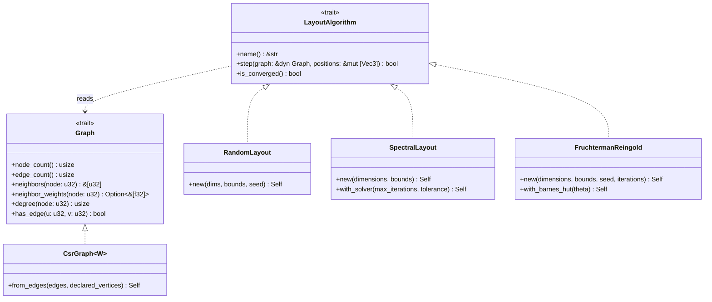
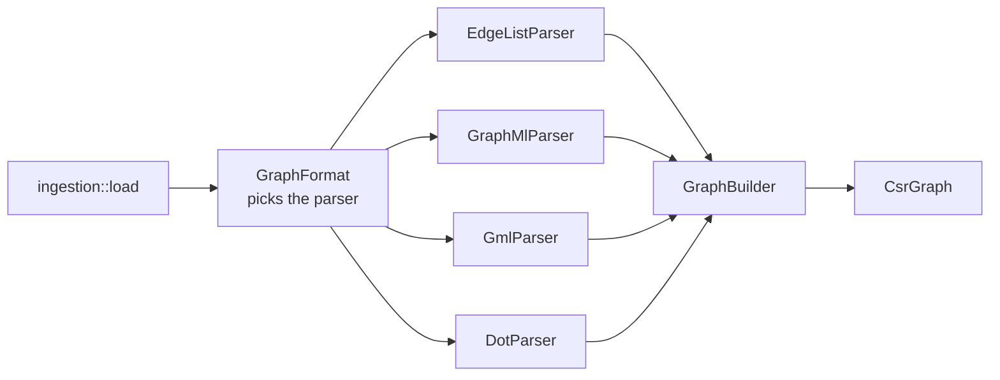

# Abstractions

Three traits separate what can vary:

| Trait | What varies | Implementations |
|---|---|---|
| `Graph` | How the graph is stored in memory | `CsrGraph` |
| `LayoutAlgorithm` | The layout algorithm | `RandomLayout`, `SpectralLayout`, `FruchtermanReingold` |
| `GraphParser` | The file format | One parser per format |

Outside the data layer, no code knows the concrete graph type. Algorithms, rendering and interface use only the `Graph` trait.



## `Graph`

```rust
pub trait Graph: Send + Sync {
    fn node_count(&self) -> usize;
    fn edge_count(&self) -> usize;
    fn neighbors(&self, node: u32) -> &[u32];
    fn neighbor_weights(&self, node: u32) -> Option<&[f32]>;
    fn degree(&self, node: u32) -> usize;
    fn has_edge(&self, u: u32, v: u32) -> bool;
}
```

- Vertices are `u32` numbers, from 0 to `node_count() - 1`.
- `edge_count` counts each edge once, although the CSR stores it in both directions.
- `neighbors` returns the neighbors in increasing order, without copying.
- `neighbor_weights` returns the weights in the same order as the neighbors, or `None` if the graph has no weights (all edges then weigh 1.0).
- `Send + Sync` lets several threads read the same graph.

## `CsrGraph`

`CsrGraph` wraps the `Csr` type of `petgraph`. It holds the three CSR arrays:

| Name in CSR literature | petgraph | Holds |
|---|---|---|
| `row_ptr` | `row` | Where the neighbors of each vertex start |
| `col_idx` | `column` | The neighbors |
| `weights` | `edges` | The weights |

There are two versions: `CsrGraph<f32>`, which stores weights, and `CsrGraph<()>`, which spends no memory on them. The choice is made automatically while reading the file ([ingestion.md](ingestion.md)).

Example with the edges (0, 1), (1, 2), (0, 2) and (2, 3):

```text
vertex        0        1        2           3
row       [   0,       2,       4,          7,      8 ]
column    [   1, 2,    0, 2,    0, 1, 3,    2 ]

neighbors of 2 = column[4..7] = [0, 1, 3]
edge_count() = 4, but the CSR stores 8 entries
```

## `LayoutAlgorithm`

```rust
pub trait LayoutAlgorithm: Send {
    fn name(&self) -> &str;
    fn step(&mut self, graph: &dyn Graph, positions: &mut [Vec3]) -> bool;
    fn is_converged(&self) -> bool;
}
```

- `positions` has one position per vertex. In 2D, the `z` coordinate is zero.
- `step` runs one iteration and returns `true` if more are needed.
- Random and Spectral finish on the first call. Force-Directed runs `Iterations` times.

## `GraphParser`

```rust
pub trait GraphParser {
    fn parse(&self, bytes: &[u8]) -> Result<GraphBuilder, ParseError>;
}

/// A problem in the file content, at the line where it was found.
pub struct ParseError { pub line: usize, pub reason: String }
```



A parser receives the file bytes and fills a `GraphBuilder`: `add_edge` for each edge and, in formats that name their vertices, `vertex(name)` to get the index. Since every format ends in the same builder, the graph in memory is the same whatever the file. If the file has an error, the parser returns the line and the reason, and `ingestion::load` adds the format name.

## Parameters

Each parameter is described as data (`ParameterSpec`: name, range, step and default value), and each algorithm lists its own in `LayoutKind::parameters()`. The interface builds its fields from that list, without knowing the algorithms. Each value is either `Auto` (computed from the graph) or `Manual` (chosen by the user).

## Messages

The interface and the engine exchange these messages:

```rust
/// Interface to engine.
pub enum LayoutCommand {
    LoadGraph(PathBuf),
    SelectAlgorithm(LayoutKind),
    SetDimensions(usize),
    SetParameter(ParameterId, Setting),
    Start,
    Stop,
}

/// Engine to interface.
pub enum GraphUpdate {
    Loaded { graph, attributes, path, load_time },
    LayoutStarted { algorithm, dimensions },
    Positions { positions, iterations },
    LayoutFinished { interrupted, iterations, elapsed },
    Failed(String),
}
```

## Extending GraphBeX

**New algorithm**

1. Implement `LayoutAlgorithm` in a file under `common/`.
2. In `application/processing.rs`, add a variant to `LayoutKind` (with `label`, `parameters` and the entry in `ALL`) and create it in `LayoutKind::build`.

The button, the menu item and the parameter fields appear on their own. The compiler warns about a missing case in `label`, `parameters` or `build`. The entry in `ALL` must be added by hand.

**New format**

1. Create the parser in `data/parsers/`, implementing `GraphParser`.
2. In `data/format.rs`, add the variant to `GraphFormat` with its extensions and its parser.

The filter of the file dialog updates on its own.

**New graph storage**

Implement `Graph`. The algorithms and the renderer do not change.
