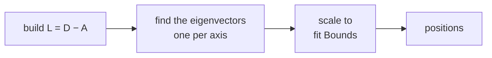
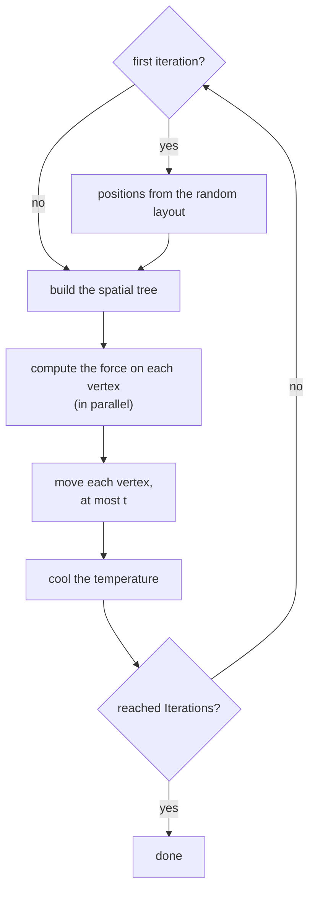
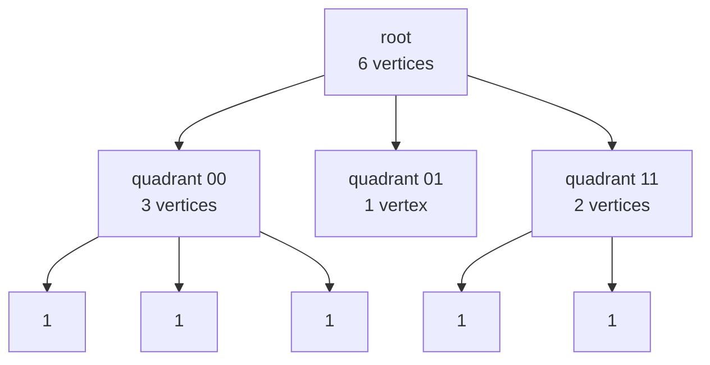

# Algorithms

GraphBeX has three layout algorithms, all in 2D and 3D:

| | Random | Spectral | Force-Directed |
|---|---|---|---|
| **Role** | Starting position | Global layout | Main algorithm |
| **Cost** | O(\|V\|) | O(d · I · (\|V\| + \|E\|)) | O(\|V\| log \|V\| + \|E\|) per iteration |
| **Iterations** | 1 | 1 | `Iterations` |
| **Deterministic** | Yes, with the same seed | Yes | Yes, with the same seed |
| **Uses weights** | No | Yes | No |
| **Code** | `random_layout.rs` | `spectral_layout.rs` | `fruchterman_reingold_layout.rs`, `barnes_hut.rs` |

## How a run works

- The engine creates the algorithm with the chosen parameters and calls `step` in a loop, on its own thread.
- Every N iterations (*Snapshot interval*), it sends a copy of the positions to the screen.
- A stop request is checked between iterations. The final positions are always sent at the end.

## Random

Each vertex gets a random position in the cube (or square) of side $2b$, with $b$ = Bounds:

$$p_v \sim \mathcal{U}\left([-b,\ b]^d\right)$$

The same seed always gives the same layout. It runs on its own when a graph is loaded and is the starting point of Force-Directed.

## Spectral

The coordinates come from the eigenvectors of the Laplacian $L = D - A$ (with weights). The eigenvectors of the $d$ smallest nonzero eigenvalues, $u_2, \dots, u_{d+1}$, give the coordinates of each vertex:

$$p_v = \left(u_2[v],\ \dots,\ u_{d+1}[v]\right)$$

How the eigenvectors are computed:

- `sprs` stores the matrix and computes the matrix-vector product. The eigenvector solver is part of GraphBeX.
- It uses the power method, which finds the **largest** eigenvalue. To find the **smallest**, it is applied to $\sigma I - L$, which has the same eigenvectors in reverse order.
- Each eigenvector found is removed from the next ones (deflation), and the constant vector is discarded.
- The starting vector is fixed, not random, so the result is always the same.
- The computation stops when the vector stops changing (*Convergence threshold*) or at the *Iteration limit*.

**Limitation:** in disconnected graphs, whole components can collapse into a single point.

## Force-Directed: Fruchterman-Reingold with Barnes-Hut

Vertices repel each other and edges pull their endpoints together, like springs. In each iteration, each vertex moves in the direction of its total force, up to a limit (the temperature) that decreases over time.

With $b$ = Bounds, $I$ = Iterations and $\delta$ the distance between two vertices:

$$k = \frac{2b}{|V|^{1/d}} \qquad f_{\text{repulsion}}(\delta) = \frac{k^2}{\delta} \qquad f_{\text{attraction}}(\delta) = \frac{\delta^2}{k} \qquad t_i = t_0\left(1 - \frac{i}{I}\right),\ t_0 = \frac{2b}{10}$$

### Barnes-Hut tree

Computing the repulsion between every pair costs O(|V|²). The Barnes-Hut tree groups nearby vertices: a distant group is treated as a single body at its center of mass.

- It is a quadtree in 2D and an octree in 3D. Each cell has up to $2^d$ children.
- A group is treated as one body when $\text{width} / \text{distance} < \theta$. With $\theta = 0$, the computation is exact.
- The tree is rebuilt every iteration. Empty cells are not created.

Example in 2D, with six vertices:

### Parallelism

The tree is built sequentially, and the forces and moves are computed in parallel with `rayon`. Threads never compete: each vertex writes only its own position.

### Design choices

- Edge weights are not used.
- The algorithm always runs `Iterations` iterations. There is no convergence criterion.
- The first iteration starts from the random layout with the same seed and Bounds.

## Automatic Bounds

Bounds starts as **Auto**. It is computed so that vertices are, on average, 20 units apart:

$$b = \max\left(10 \cdot |V|^{1/d},\ 10\right)$$

Larger graphs therefore take more space instead of being squeezed. With 200,000 vertices in 3D, for example, $b \approx 585$. With no graph loaded, it is 100.

## Parameters

| Parameter | Algorithms | Default | Range |
|---|---|---|---|
| Bounds | all | Auto | 1 to 10⁶ |
| Seed | Random, Force-Directed | 42 | 0 to 2³² − 1 |
| Iteration limit | Spectral | 2,000 | 1 to 10⁶ |
| Convergence threshold | Spectral | 10⁻⁹ | 10⁻¹⁵ to 10⁻¹ |
| Iterations | Force-Directed | 500 | 1 to 10⁶ |
| Barnes-Hut theta | Force-Directed | 0.8 | 0 to 2 |
| Snapshot interval | Force-Directed | 10 | 1 to 10⁴ |

- Algorithms that use the same parameter share its value.
- Changing a parameter does not restart the layout. It applies to the next Run Layout.
