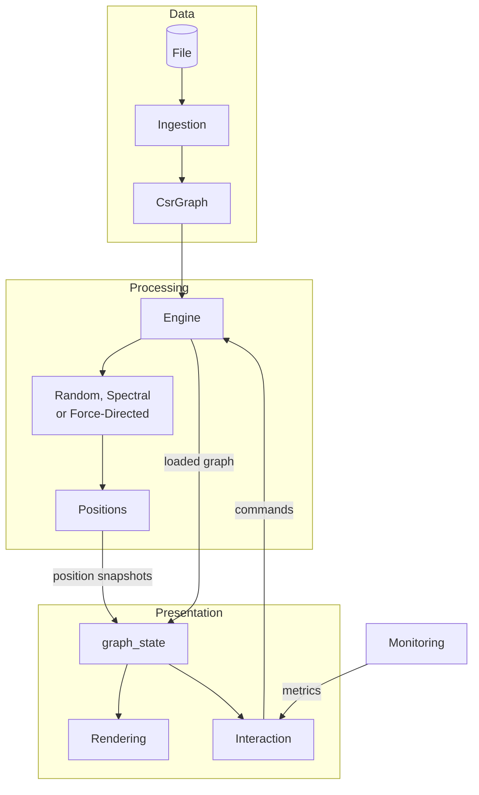
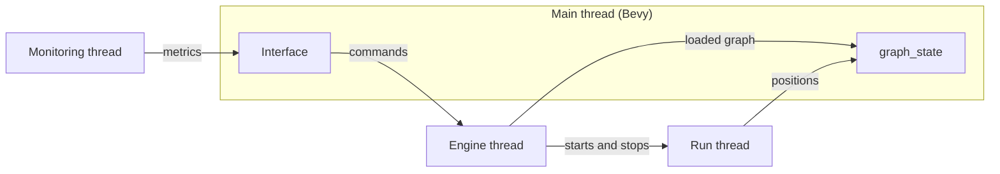
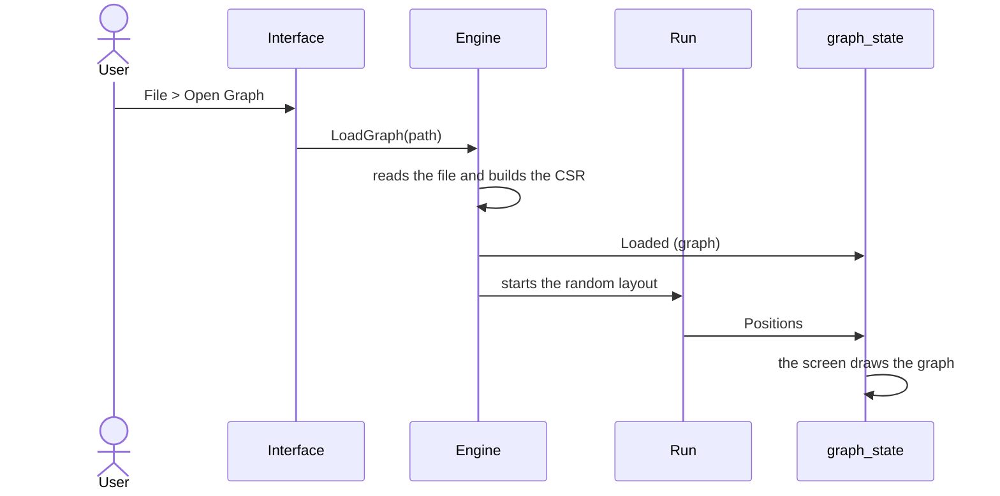
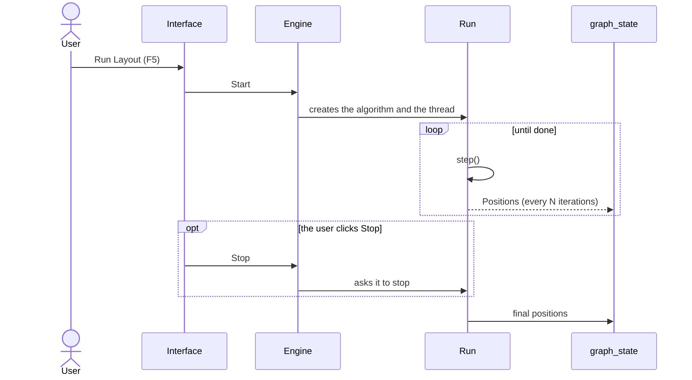
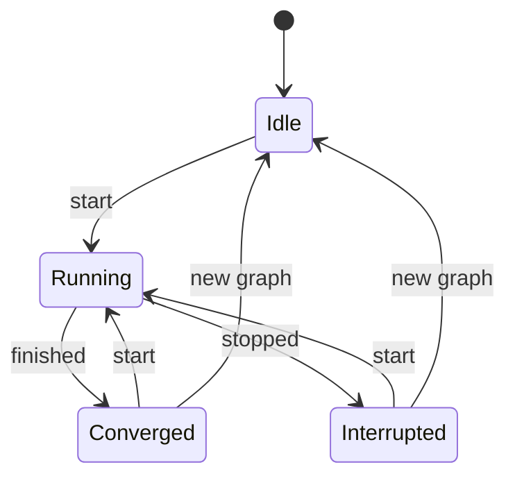
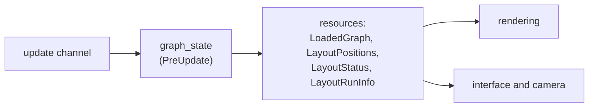

# Architecture

## Layers

GraphBeX has three layers. Data flows in one direction: a file becomes a graph, the processing layer computes positions, and the presentation layer draws them. The interface talks to the processing layer only through commands.



## Modules

| Module | Code | Runs on |
|---|---|---|
| Ingestion | `data/` | Engine thread |
| Processing | `application/processing.rs`, `common/` | Engine thread, one thread per run and the `rayon` pool |
| Rendering | `presentation/rendering.rs` | Main thread (Bevy) |
| Interaction | `presentation/interaction/` | Main thread (Bevy) |
| Monitoring | `application/monitoring.rs`, `presentation/metrics.rs` | Its own thread |

Code paths in these documents are relative to `src/modules/`.

## Code

```text
.
├── Cargo.toml
├── build.rs                executable icon (Windows)
├── data/graph/             compressed sample graphs
├── docs/
└── src/
    ├── main.rs             creates the engines, the channels and the Bevy app
    └── modules/
        ├── common/         Graph and LayoutAlgorithm traits, CSR and algorithms
        ├── data/           file reading (one parser per format)
        ├── application/    processing engine, parameters and monitoring
        └── presentation/   graph_state, rendering, camera and interface
```

`common` depends on no other module of the project, and the others depend on it.

## Threads and channels



| Thread | Role |
|---|---|
| Main | Runs Bevy: interface, camera and rendering |
| Engine | Waits for commands and loads graphs. Uses no CPU while idle |
| Run | Runs one layout and ends when it converges or is stopped |
| `rayon` pool | Computes the Force-Directed forces in parallel |
| Monitoring | Reads CPU and RAM every second |
| Dialogs | Open the file dialogs without freezing the window |

The channels come from `crossbeam-channel`. Three rules keep the interface responsive:

- The graph never changes after loading and is **shared** (`Arc`), never copied.
- The positions belong to the run, and the interface receives **copies**.
- The interface **never waits**. It reads the channels once per frame, without blocking.

## Flows

### Loading a graph



Every loaded graph gets the random layout right away, so it never shows all vertices stacked at the origin. If reading fails, the error appears in the status bar.

### Running and stopping a layout



Loading another graph, changing the algorithm or changing the dimensions also stops the run. Changing a parameter does not. It applies to the next run.

### Layout state



## Inside Bevy

`main.rs` builds the Bevy app with five plugins of the project: `GraphStatePlugin`, `MetricsPlugin`, `Rendering`, `Interaction` and `WindowIconPlugin`.

A channel delivers each message to a single reader, but the interface and the renderer need the same state. So `graph_state` reads the channel once per frame, before everything else, and stores the result in Bevy resources. The other systems only read those resources.



| Resource | Content |
|---|---|
| `LoadedGraph` | Loaded graph, attributes and file path |
| `LayoutPositions` | Latest positions received |
| `LayoutStatus` | Idle, Running, Converged or Interrupted |
| `LayoutRunInfo` | Algorithm, dimensions and iterations of the current run |
| `UiSelection` | User choices (algorithm, dimensions, parameters), mirroring the engine |

When the window closes, the channels are dropped, and the engine and the monitoring thread end on their own.
