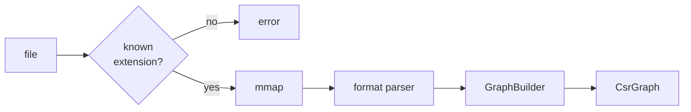
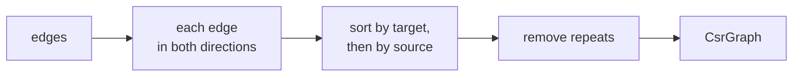

# Ingestion

Reading a file takes two steps: the file is **memory mapped** (mmap) and a **parser** for its format reads the bytes. After that, everything uses the graph in CSR form.

With mmap, the operating system loads the file on demand, so it does not need to fit in RAM at once. Reading runs on the engine thread, and the interface keeps responding.

## Formats

| Format | Extensions | How it is read | Edge weight |
|---|---|---|---|
| Edge List | `.el`, `.csv`, `.txt` | One edge per line: `u v [weight]`. Lines starting with `#` are comments | Third field |
| GraphML | `.graphml` | XML read as a stream, without loading the whole tree (`quick-xml`) | `<data>` of the `weight` key |
| GML | `.gml` | Read token by token | `weight`, or `value` |
| DOT | `.dot`, `.gv` | Parser for the Graphviz grammar | `weight` attribute |

Rules for every format:

- The graph is always treated as **undirected**.
- An edge without a weight weighs 1.0. Invalid weights (`NaN`, infinity) are rejected.
- Repeated edges are stored once.
- In GraphML, GML and DOT, vertices have text names. Each name becomes a number (0, 1, 2...) in order of appearance, and vertices without edges are kept.
- The format is recognized **by the extension only**.

Known limitations:

- **Edge List:** vertices are already numbers, so the largest number sets how many vertices exist. Missing numbers become isolated vertices. Fields after the third are ignored without warning.
- **GML:** nested lists, such as `graphics [ ... ]`, are ignored.
- **DOT:** a default weight (`edge [weight=2]`) is not applied, and only the first graph in the file is read.

## `GraphBuilder`

Every parser hands its edges to a `GraphBuilder`. It only creates the weight array when the first edge with a weight other than 1.0 appears. A file without weights becomes a `CsrGraph<()>`, which spends no memory on them.

## Building the CSR

The CSR is built in linear time, O(|V| + |E|):

Sorting uses two passes of counting sort, each in linear time, instead of a comparison sort, which would cost O(|E| log |E|).

## Memory

Example with 10⁷ vertices and 10⁸ CSR entries:

| Array | Size per item | Total |
|---|---|---|
| `row` | 8 bytes per vertex | ≈ 80 MB |
| `column` | 4 bytes per entry | 400 MB |
| `edges` (weights) | 4 bytes per entry, or nothing | 400 MB, or 0 |
| **Total** | | **0.48 GB without weights, 0.88 GB with weights** |

- Each edge takes two entries, one per direction. The 10⁸ entries of the example are about 5 · 10⁷ edges.
- While building, memory use is higher because of the temporary copies of the sort. The final CSR has the size in the table.

## Vertex attributes

GraphML, GML and DOT can carry vertex attributes, such as a community. They are stored apart from the CSR and are used only for coloring by attribute ([presentation.md](presentation.md#color-by-attribute)).

## Errors

An invalid file produces an error with the format, the line and the reason, for example `malformed GML at line 2: a node has no id`. The error appears in the status bar.

The GML and DOT tokenizers share the same cursor over the bytes (`parsers/scanner.rs`), which counts lines as it advances.
