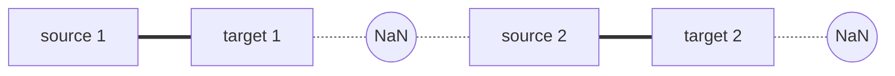

# Presentation

Everything here runs on the main thread, inside Bevy. The presentation layer only reads state. To change the layout, it sends a command to the engine.

## Rendering

### Vertices

- Each vertex is a small sphere, and all of them are drawn in a single GPU call (instancing). One entity holds, in a GPU buffer, the position and color of every vertex: 28 bytes per vertex (`presentation/instancing.rs`).
- The vertex shader (`presentation/vertices.wgsl`) does its own lighting: one fixed light and an ambient term, the same for every color.
- The sphere has 320 triangles, or 20 in graphs with more than 100,000 vertices, so the GPU can handle large graphs.

### Edges

- Edges are drawn with `bevy_polyline`, which makes one GPU call per line. To avoid one call per edge, edges are grouped in batches of 65,536.
- In a batch, all points are joined in sequence. To separate the edges, an invalid point (NaN) is placed between them, and the GPU discards the segments that touch it:



*Thick lines are drawn, and dotted ones are discarded.*

- **Risk:** this discard works on current drivers, but the Vulkan specification does not guarantee it.

### Color by attribute

View > Color By lists the vertex attributes of the file, and vertices are colored by category, with 12 colors that repeat. There is no legend.

## Camera

| | 3D | 2D |
|---|---|---|
| **Projection** | Perspective | Orthographic, from the front |
| **Rotate** | Left button | No rotation |
| **Pan** | Right button | Any button |
| **Zoom** | Mouse wheel | Mouse wheel |

- The camera frames the graph when it is new and when the algorithm or the dimensions change. Running the same layout with other parameters keeps the camera where it was. Home frames the graph again.
- The 2D or 3D mode follows the dimensions of the computed layout, not the selected button.
- Dragging over the interface does not move the camera.

## Vertex selection

- A click without dragging selects the vertex drawn under the pointer, and a click on empty space clears the selection.
- The search runs only on click. Each vertex is projected on the screen and, among those under the cursor, the one closest to the camera wins. Distant vertices stay clickable within a minimum radius of 6 pixels.
- The vertices, the selected one and its neighbors have their own colors in each mode ([Theme](#theme)).
- The edges of the selected vertex are drawn thicker in the accent blue, on top of the gray ones.
- The Selection section of the panel shows the index, degree and position of the vertex, updated during the layout.

## Interface

```text
┌───────────────────────────────────────────────────────────────────────────────┐
│ football.gml - GraphBeX - Graph Visualizer                     (window title) │
├───────────────────────────────────────────────────────────────────────────────┤
│ File   Layout   View   Help                                        (menu bar) │
├───────────────────────────────────────────────────────┬───────────────────────┤
│                                                       │ Layout                │
│                                                       │ [ Random           ]  │
│                                                       │ [ Spectral         ]  │
│                     2D / 3D canvas                    │ [ Force-Directed   ]  │
│         (the graph is drawn behind the interface)     │ Parameters            │
│                                                       │ Dimensions [2D][3D]   │
│                                                       │ algorithm fields      │
│                                                       │ [Run Layout] [Stop]   │
│                                                       │ Selection             │
│                                                       │ id, degree, position  │
├───────────────────────────────────────────────────────┴───────────────────────┤
│ file  V vertices  E edges │ algorithm: state     CPU  RAM  VRAM  FPS  Iter    │
└───────────────────────────────────────────────────────────────────────────────┘
```

| Menu | Items |
|---|---|
| File | Open Graph (Ctrl+O), Export Layout, Save Screenshot, Exit |
| Layout | Algorithms, 2D/3D, Run Layout (F5), Stop Layout |
| View | Reset View (Home), Performance Panel, Dark Mode, Color By |
| Help | Controls, About |

- Files are chosen in the native dialog of the operating system.
- The interface only shows what works: the algorithm buttons, the parameter fields and the file filter are generated from lists in the code.
- **Export Layout** saves the positions of the latest snapshot as CSV, one line per vertex: `id,x,y,z`.
- **Save Screenshot** saves the graph as PNG, using Bevy's own capture. The interface is hidden in the captured frame, so the image has the whole canvas, without menus or panels.

## Theme

Colors, fonts, icons and sizes live in `interaction/theme.rs`.

There is a light and a dark mode. The app starts in the system mode (Bevy reads the theme when it creates the window), and View > Dark Mode switches modes. The choice is not saved. The window title bar follows the mode.

| Role (`Tone`) | Light | Dark | Use |
|---|---|---|---|
| Accent blue | `#3B82F6` | `#60A5FA` | Edges of the selected vertex, active option, check marks and the X of the logo |
| Background | `#F8FAFC` | `#0F172A` | Canvas and value boxes |
| Surface | `#FFFFFF` | `#1E293B` | Bars, panel, menus and buttons |
| Border | `#E2E8F0` | `#334155` | Borders and separators |
| Primary text | `#1F2937` | `#F8FAFC` | Text |
| Secondary text | `#64748B` | `#94A3B8` | Labels, shortcuts and icons |
| Error | `#DC2626` | `#F87171` | Error in the status bar |
| Logo name | `#475569` | `#F8FAFC` | "GraphBe" |
| Vertex | `#93C5FD` | `#3B82F6` | Vertices without highlight |
| Selected vertex | `#FBBF24` | `#FBBF24` | Yellow in both modes |
| Neighbor | `#475569` | `#94A3B8` | Neighbors of the selected vertex |
| Edge | `#64748B` | `#334155` | Edges |

- Each interface node states the role of its colors with the `Fill`, `Stroke` and `Ink` components, and the `theme::paint` system applies the color of the mode when the node appears or the mode changes. Systems that already paint every frame (buttons, menus) read the mode directly.
- The **Inter** font (Medium and SemiBold, SIL OFL 1.1) and the **Lucide** icons (ISC) are embedded in the executable. Inter Medium replaces Bevy's default font.
- The status bar metrics use tabular figures (`tnum`) and pad with figure spaces, so the bar does not shake when the FPS changes.
- Icons follow the actions (`ControlAction::icon()`), in the menus and in the panel buttons.
- The logo in the menu bar is the symbol (the same PNG as the window icon) followed by "GraphBeX", with the X in the accent color.

## Metrics

| Metric | Source |
|---|---|
| CPU and RAM | `sysinfo`, on its own thread, every second |
| VRAM | wgpu counters |
| FPS | Bevy |
| Load time and iterations | Engine messages |

- The status bar shows CPU, RAM, VRAM, FPS and iterations. The Performance Panel shows the details, such as per-core usage and time per iteration.
- VRAM is the memory GraphBeX allocated in GPU buffers and textures, as counted by wgpu. It is not the total used by the driver.
- On the first reading, GraphBeX checks the minimum requirements (4 cores and 8 GB of RAM) and writes the result to the log.
